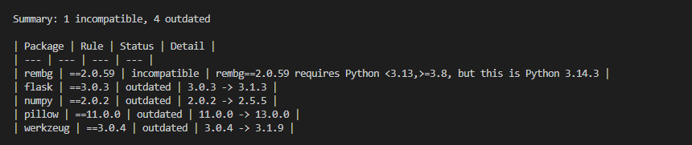

<p align="center"></p>

# Python Dependency Doctor

An agent skill plus a small standalone script that audit a Python project's
dependencies: which pins are outdated, and which ones will not install on your
Python version.

Pins rot quietly. `rembg==2.0.59`, for example, only supports Python 3.8 to 3.12,
so it fails to install on Python 3.14. This tool finds problems like that before
they stop you, and the skill teaches an AI coding agent how to fix them safely.



## What it checks

- **incompatible:** the pinned version does not support your (or a target) Python version
- **outdated:** a newer release exists on PyPI
- **unpinned / range:** dependencies with no version rule, or only a range
- **unknown:** PyPI could not be reached or does not know the package

It also reads the UTF-16 requirements files that `pip freeze >` creates in
Windows PowerShell.

## Example

Checking an old `requirements.txt` against Python 3.14.3:

```
## requirements.txt (checked against Python 3.14.3)

Summary: 1 incompatible, 4 outdated

| Package | Rule | Status | Detail |
| --- | --- | --- | --- |
| rembg | ==2.0.59 | incompatible | rembg==2.0.59 requires Python <3.13,>=3.8, but this is Python 3.14.3 |
| flask | ==3.0.3 | outdated | 3.0.3 -> 3.1.3 |
| numpy | ==2.0.2 | outdated | 2.0.2 -> 2.5.5 |
| pillow | ==11.0.0 | outdated | 11.0.0 -> 13.0.0 |
| werkzeug | ==3.0.4 | outdated | 3.0.4 -> 3.1.9 |
```

Versions come from PyPI on the day you run it.

## Use it as an agent skill

Copy the `skills/python-deps-doctor` folder into your agent's skills folder
(for Claude Code, that is `~/.claude/skills/`). Then ask your agent something
like "audit my dependencies" or "pip install fails on Python 3.14, fix my
requirements.txt". The skill tells the agent to run the script, read the
report, upgrade in a fresh virtual environment, test, and report before and
after.

## Use the script on its own

```
python skills/python-deps-doctor/scripts/audit.py path/to/project
python skills/python-deps-doctor/scripts/audit.py path/to/project --python 3.14.3
```

It needs Python 3.8 or newer and the `packaging` library (installed with pip).
Exit code 0 means nothing needs action, 1 means something is incompatible or
outdated, 2 means no requirements file was found. That makes it usable in CI.

## Limits

- Reads `requirements*.txt` only. `pyproject.toml` support is planned.
- Does **not** check for security vulnerabilities. Use `pip-audit` or Dependabot
  for that. The skill tells the agent not to claim otherwise.
- Checks the packages listed in the file, not their sub-dependencies.
- Needs internet access to pypi.org.
- Tested on Windows with Python 3.12. It has not yet been tested with every
  agent, so feedback is welcome.

## Development

```
pip install pytest packaging
python -m pytest
```

The tests use fake PyPI responses, so they run without a network connection.

## Feedback

Found a case it gets wrong? Open an issue and paste the report it printed.

## License

MIT

## Notes

Built with AI assistance. The code was reviewed and tested by the author.
